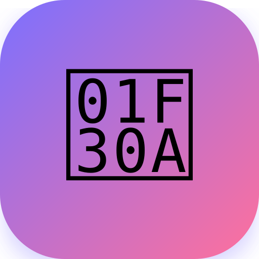

<div align="center">



# 🌊 HabitFlow

### Build better habits — one day at a time.

A beautifully designed, **mobile-first progressive web app (PWA)** built with pure modern web standards.  
No servers. No mandatory accounts. Works 100% offline with background alarms & local data privacy.

<br/>

[](https://habittracer.vercel.app)
&nbsp;
[](https://habittracer.vercel.app)
[](#-install-on-mobile-pwa--desktop)
[](#-privacy)
[](#-license)
[](#️-project-structure)

<br/>

</div>

---

## 📸 Screenshots & Highlights

> Open on mobile for the best native app experience — or test on desktop with full PWA installation!

| 🏠 Today Dashboard | 📈 Progress & Analytics | 🎯 Challenge & Roadmaps |
|:---:|:---:|:---:|
| _Live streak, habits, 7-day strip_ | _Canvas trends, 30-day stats, breakdown_ | _Countdown ring, day grid, career roadmaps_ |

> 💡 **Tip:** Tap **"Add to Home Screen"** or **"Install App"** in your browser for a true native app feel with full-screen view and standalone taskbar integration.

---

## ✨ Features at a Glance

```
🏠 Today      →  Accurate local streak, habit cards, 7-day strip, progress bar, confetti
📊 Stats       →  6 overview metrics, 4-week heatmap, 12-month calendar, habit performance
➕ Add          →  Custom name, 112+ categorized emojis, 32 color swatches, iPhone alarm
🎯 Challenge  →  7–100 day countdowns, ring progress, tech career challenges & roadmaps
📈 Progress   →  Canvas chart (7D/14D/30D/60D), moving average trend, Reset Habit Days
⏰ Alarms     →  Apple iPhone "Radar" ringtone, background push alerts, Service Worker (sw.js)
```

<details>
<summary><strong>📋 Full Feature Breakdown</strong></summary>

<br/>

### 🏠 Today Dashboard
- **100% Accurate Day Streak** — tracks consecutive active days in your local timezone without UTC offset glitches.
- **Daily completion percentage** — live animated progress bar.
- **7-day week view** — status dots for recent days with mint green completion highlights.
- **Challenge mini card** — live countdown and SVG ring progress to your active goal.
- **Habit cards** — tap to mark done with particle confetti burst 🎊, drag-and-drop or touch reordering, and instant `🔥 1d` flame badges.

### 📊 Stats Page
- **6 overview cards** — Total Habits, Today's Done, Streak Days, Weekly Rate, Challenge Day, Days Left.
- **🔥 4-Week Heatmap** *(collapsible)* — color-coded 28-day activity matrix.
- **📅 Yearly Calendar** *(collapsible)* — full 12-month interactive view.
- **Habit Performance** — per-habit 30-day goal completion bars + streak badges + one-tap Edit modal.

### ➕ Add Habit
- Custom name (up to 30 characters).
- **112+ Curated Emojis** — categorized across Fitness, Health, Productivity, Cybersecurity/Tech, Faith, Hobbies, and Home.
- **32 Vibrant Color Swatches** — modern dark-mode palette spanning purples, blues, mints, yellows, oranges, and pinks.
- Daily alarm time with in-app **"🔔 Test iPhone Ringtone"** preview button.

### 🎯 Day Challenge & Career Roadmaps
- Personal goal name (e.g. "Learn Quran", "75 Hard", "Bug Bounty Hunting").
- Preset durations: **7 / 21 / 30 / 60 / 75 Hard / 100 days** or custom days (1–365).
- Circular SVG progress ring with live percentage and days left.
- 100-day visual status grid (Upcoming / Passed / Today).
- **Career Challenge Suggestions** — Hacker, Pentester, Bug Hunter, Developer, Security Analyst.
- **Interactive Cybersecurity Roadmaps** — Bug Hunting, CEH, OSCP, eJPT, Pentesting (with detailed steps and tech tags).

### 📈 Progress Graph & Habit Breakdown
- **Interactive Canvas Chart** — daily completion rate with a moving average trend line.
- Time range filters: **7D / 14D / 30D / 60D**.
- Hover & touch tooltip displaying exact date and completion percentage.
- **30-Day Stats & Best Day Card** — calculates best day achievements and average rates.
- **Habit Breakdown** — per-habit bar performance with day counts (`Xd`).
- **↺ Reset Habit Days Button** — safely resets habit day counts and streaks to `0` with confirmation, keeping all habit names and settings intact.

### ⏰ Advanced Alarm System & Service Worker
- **Apple iPhone "Radar" Ringtone** — synthesized in real-time via Web Audio API using multi-oscillator acoustic harmonics (pure sine bell + triangle resonance) for 100% offline zero-dependency playback.
- **Continuous Looping Alarm** — rings rhythmically with matching device vibration pulses until dismissed or marked done.
- **True Background Alarms (`sw.js`)** — scheduled notifications ring even when the tab or browser is closed!
- **Action Buttons in Notification** — tap **"✓ Mark Done"** directly from your lock screen or **"🔔 Open Alarm"** to jump into the app.

</details>

---

## 🗂️ Project Structure

```
Habit_Tracker/
├── index.html           ← Main application (PWA Single Page App, ~3,500 lines)
├── sw.js                ← Service Worker (Offline caching & Background Alarms)
├── manifest.json        ← Web App Manifest for PWA installation
├── icon-192.png         ← 192x192 PWA & Android app icon
├── icon-512.png         ← 512x512 High-DPI PWA splash icon
├── apple-touch-icon.png ← 180x180 iOS Safari home screen icon
├── favicon.png          ← 64x64 browser tab icon
├── favicon.ico          ← Legacy browser favicon
├── icon.svg             ← Scalable vector logo
└── README.md            ← This documentation file
```

Everything is self-contained with **zero external npm packages or build tools**:

| File | Purpose |
|------|---------|
| `index.html` | UI layout, CSS styles, canvas graphics, Web Audio iPhone ringtone engine, and state management |
| `sw.js` | Service Worker handling background push alarms, notification clicks, and offline cache |
| `manifest.json` | PWA manifest defining standalone display mode, orientation, theme color, and maskable PNG icons |
| `icon-*.png` | High-res PNG icons for Chrome/Edge install dialog, Android home screen, and taskbars |

---

## 🚀 Getting Started

### Option 1 — Try it Online
```
https://habittracer.vercel.app
```
Open in any modern browser. Zero setup required.

---

### Option 2 — Run Locally

**Clone or download the workspace:**
```bash
git clone https://github.com/your-username/habitflow.git
cd habitflow
```

**Serve locally** (recommended for Service Worker and PWA install):
```bash
# Using Python
python -m http.server 8080

# Using Node.js
npx serve .

# Or using VS Code "Live Server" extension:
# Right-click index.html → "Open with Live Server" (http://127.0.0.1:5500)
```

---

## 📲 Install on Mobile (PWA) & Desktop

### 📱 iPhone / iPad (iOS)
1. Open the URL in **Safari**.
2. Tap the **Share** button `📤` at the bottom.
3. Scroll down and tap **"Add to Home Screen"**.
4. Tap **Add** — done! HabitFlow will open full-screen with the official app icon.

### 🤖 Android
1. Open the URL in **Google Chrome**.
2. Tap the **⋮ three-dot menu** (top right).
3. Tap **"Add to Home screen"** or **"Install app"**.
4. Tap **Install** — done!

### 💻 Desktop (Google Chrome / Microsoft Edge)
1. Open `http://localhost:8080/index.html` or live URL.
2. Look at the address bar and click the **Install icon** (or menu → **"Install HabitFlow"**).
3. The prompt will display the official **HabitFlow Gradient Logo**.
4. Click **Install** — HabitFlow launches in its own dedicated, borderless app window!

---

## 💾 Data & Storage

All data lives entirely inside your browser's `localStorage` under the key **`hf_v5`**.

### Schema
```json
{
  "habits": [
    {
      "id": 1700000000000,
      "name": "Morning Run",
      "emoji": "🏃",
      "color": "#7c6fff",
      "time": "07:00",
      "streak": 5,
      "completions": {
        "2026-10-13": true,
        "2026-10-14": true
      },
      "order": 0
    }
  ],
  "globalStreak": 5,
  "selEmoji": "🏃",
  "selColor": "#7c6fff",
  "challenge": {
    "goalName": "Bug Bounty Hunter",
    "totalDays": 30,
    "startDate": "2026-10-01"
  }
}
```

### Backup & Restore

**Backup:**
```javascript
// Copy this from DevTools Console:
copy(localStorage.getItem('hf_v5'));
```

**Restore:**
```javascript
// Paste in DevTools Console:
localStorage.setItem('hf_v5', '<paste your JSON here>');
location.reload();
```

---

## ⏰ Alarm System Details

| Layer | Technology | Works when closed? |
|-------|-----------|-------------------|
| 🔊 Sound | Web Audio API (Apple iPhone "Radar" Alarm Ringtone) | ✅ Auto-rings on open/wake |
| 📳 Vibration | Vibration API (iOS rhythmic alarm pulse) | ✅ Supported mobile devices |
| 🔔 Push Notification | Service Worker (`sw.js`) + Notification Triggers | ✅ Background & PWA active |

> **iPhone Radar Sound:** Synthesized via Web Audio API with multi-oscillator acoustic harmonics for zero-dependency offline fidelity.  
> **Preview Button:** Test and listen to the ringtone anytime in the Add Habit and Edit Habit modals.

---

## 🎨 Design System

### Color Palette
| Variable | Hex | Usage |
|----------|-----|-------|
| `--bg` | `#0a0a0f` | Deep obsidian page background |
| `--s1` | `#13131a` | Card & container surface |
| `--s2` | `#1c1c27` | Elevated surface & modals |
| `--bd` | `#2a2a3a` | Subtle borders |
| `--a` | `#7c6fff` | Primary accent — Iris Violet |
| `--b` | `#ff6f9c` | Secondary accent — Neon Pink / Alert |
| `--c` | `#6fffc4` | Success — Mint Green |
| `--t` | `#f0f0ff` | Primary crisp text |
| `--td` | `#8888aa` | Dimmed secondary text |
| `--tf` | `#44445a` | Faint tertiary text |

### Typography
- **[Syne](https://fonts.google.com/specimen/Syne)** `700, 800` — Headings, numbers, button labels
- **[DM Sans](https://fonts.google.com/specimen/DM+Sans)** `400, 500, 600` — Body, descriptions, inputs

---

## 📋 Browser Compatibility

| Browser | Version | Support |
|---------|---------|---------|
| Google Chrome | 90+ | ✅ Full (PWA, Service Worker, Web Audio, Notifications) |
| Microsoft Edge | 90+ | ✅ Full (PWA, Service Worker, Web Audio, Notifications) |
| Safari (iOS & macOS) | 14+ | ✅ Full (Add to Home Screen, Web Audio, PWA) |
| Mozilla Firefox | 90+ | ✅ Full |
| Samsung Internet | 14+ | ✅ Full |
| Opera | 76+ | ✅ Full |

---

## 🔒 Privacy & Offline Integrity

| Policy | Status |
|--------|--------|
| 📡 Data sent to external servers | **None (Zero)** |
| 🍪 Cookies or trackable storage | **None** |
| 📊 Analytics, telemetry, trackers | **None** |
| 🔐 Account / registration required | **No** |
| 📦 Data storage location | **Device localStorage only** |

Works 100% offline after the first visit via Service Worker cache.

---

## 🗺️ Roadmap & Changelog

- [x] **Service Worker (`sw.js`)** — offline caching and background alarm push notifications
- [x] **Authentic Apple iPhone "Radar" Ringtone** — Web Audio API dual-oscillator acoustic synthesizer
- [x] **PWA Logo & App Icons** — High-res 192px/512px PNG suite + SVG vector + favicon
- [x] **Reset Habit Days Feature** — reset completions and streaks to 0 without deleting habits
- [x] **100% Accurate Local Timezone Streak Engine** — eliminates UTC offset bugs & instant Day 1 flame badge
- [x] **Expanded Emojis & Colors** — 112+ curated symbols and 32 modern color swatches
- [ ] JSON Export / Import cross-device backup UI
- [ ] Multiple simultaneous challenges
- [ ] Light / dark theme toggle
- [ ] Habit notes & journal logs

---

## 📄 License

MIT License — Copyright (c) 2026 HabitFlow

Permission is hereby granted, free of charge, to any person obtaining a copy of this software and associated documentation files (the "Software"), to deal in the Software without restriction, including without limitation the rights to use, copy, modify, merge, publish, distribute, sublicense, and/or sell copies of the Software, and to permit persons to whom the Software is furnished to do so, subject to the following conditions:

The above copyright notice and this permission notice shall be included in all copies or substantial portions of the Software.

THE SOFTWARE IS PROVIDED "AS IS", WITHOUT WARRANTY OF ANY KIND, EXPRESS OR IMPLIED, INCLUDING BUT NOT LIMITED TO THE WARRANTIES OF MERCHANTABILITY, FITNESS FOR A PARTICULAR PURPOSE AND NONINFRINGEMENT.

---

<div align="center">

**⭐ If HabitFlow helps you build better habits, consider starring the repo!**

<br/>

_Made with 🌊 — Build habits, change your life._

---

### 📢 Stay Updated
Join our WhatsApp channel for daily cyber updates, vulnerability write-ups, and security news!

👉 **[Join Our WhatsApp Channel](https://whatsapp.com/channel/0029Vb5n1UC7oQhYnrlUBD26)**

---
*Maintained by **Muhammad Rehan Afzal** | Founder, TeamCyberOps*

</div>
